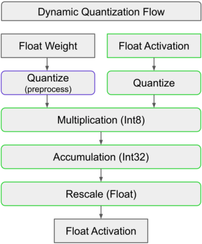
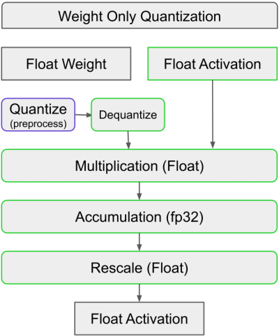

# 第 1 章　量化概览（Overview of Quantization）

> 译自 Christian Mills 的 [GPU MODE 第 7 讲](https://christianjmills.com/posts/cuda-mode-notes/lecture-007/#overview-of-quantization)，原文发表于 2024 年 9 月 10 日。

## 量化概览（Overview of Quantization）

- **目标**：通过降低权重和／或激活的精度，实现更快的推理。
- **类型**：动态量化与仅权重量化。

**动态量化（Dynamic Quantization）：**

*第 3 页：动态量化流程。*

- **权重**：量化为整数。
- **激活**：量化为整数。
- **乘法**：执行整数乘法，速度比浮点乘法更快。
- **累加**：累加计算结果，重新缩放，再以浮点形式输出。
- **优点**：适用于计算受限（compute-bound）的模型，例如 Segment Anything。
- **示例**：两个 INT8 张量相乘的速度，约为两个 BF16 张量相乘的 4 倍。

**仅权重量化（Weight-only Quantization）：**

*第 3 页：仅权重量化。*

- **权重**：量化为整数。
- **激活**：保持原始精度，即浮点格式。
- **乘法**：可以直接让整数权重与浮点激活相乘，使用混合数据类型（mixed-dtype）；也可以先对权重反量化，再进行乘法。
- **优点**：
  - 权重加载非常快。
  - 适用于内存带宽受限（memory-bound）的模型，例如 LLaMA。
  - 因为没有量化激活，准确性高于动态量化。
- **为什么仅权重量化不量化激活？**
  - 在内存带宽受限的场景中，首要任务是快速加载权重。
  - 量化激活会引入额外的计算与内存开销，在这些场景中，开销超过了收益。
  - 对于 LLaMA 这类内存带宽受限的模型，与仅权重量化相比，动态量化往往反而会降低速度。

**术语说明：**

“INT4 量化”这个说法不够明确。应当同时说明权重和激活的数据类型，例如 W4A16，或采用 FP32 累加的 W4BF16。

**量化时需要考虑的因素：**

- **模型是否容易量化**：不同模型对量化的适应程度并不相同。
  - **分类模型**：通常较容易量化。
  - **回归模型**：量化更具挑战。
  - **GPTQ（Generative Pretrained Transformer Quantization）**：GPT Fast 中为 INT4 实现了这一方法，使量化不必依赖某一种特定模型。
- **量化感知训练（Quantization-Aware Training，QAT）**：在训练中模拟量化，以提高模型适应量化的能力。
  - 梯度通过模拟量化算子进行反向传播。
- **量化粒度**：
  - **逐张量（per-tensor）**：整个张量使用一个缩放因子。
  - **逐通道（per-channel）**：每个输出通道使用不同的缩放因子。
  - **逐词元、逐向量、逐块（per-token、per-vector、per-block）**：其他可采用的粒度。
  - 粒度越细，准确性通常越好，但也需要更多内存来存储更多缩放因子。
- **精度选择**：可以采用 8 位、4 位，甚至 1 位量化。
  - **位宽**：更低的位宽，例如 1 位，虽然可行，但往往会导致准确性明显下降，更适合简单任务。
- **离群值与分布**：量化效果受权重和激活的分布影响，离群值会损害准确性。

> **译者注**：本节“约 4 倍”是原文的示例数字，并非所有 GPU、矩阵形状和端到端推理场景都适用。模型是否受计算或带宽限制，也与批量大小、算子形状及硬件有关。图内英文保留，中文图题和相邻文字对应说明其含义。
