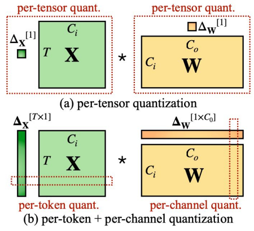

# 第 2 章　动态量化内核（Dynamic Quantization Kernels）

> 译自 Christian Mills 的 [GPU MODE 第 7 讲](https://christianjmills.com/posts/cuda-mode-notes/lecture-007/#dynamic-quantization-kernels)，原文发表于 2024 年 9 月 10 日。

## 动态量化内核（Dynamic Quantization Kernels）

- **最初的方法**：利用 `torch.compile()`，从 Python 代码生成 Triton 内核。
- **数学表达**：
  - 基本线性运算：`Y = X.W`。
  - 将缩放因子提取出来后的量化运算：`Y = Sx * Sw * (Xint.Wint)`，其中 `Xint` 和 `Wint` 分别是 `x` 和 `w` 的量化版本。
  - **Triton 教程**：[矩阵乘法](https://triton-lang.org/main/getting-started/tutorials/03-matrix-multiplication.html)。
- **逐词元与逐通道量化**：GPU 的并行处理能力使这两种量化方式能够高效执行。

*第 7 页。*

- **挑战**：
  - **内存占用增加**：INT8 乘法的中间结果以 INT32 实体化存储时，内存开销会高于 BF16。
- **解决办法**：
  - 将重新缩放操作（`sw`）融合进 Triton 内核，避免将 INT32 中间结果单独实体化存储。
  - **实现方式**：
    - 修改 Triton 内核，加入重新缩放所需的乘法。
    - 在 Torch Compile 中使用 `config.force_fuse_int_mm_with_mul = True`，强制执行融合。
    - 对应代码：`torch/_inductor/kernel/mm.py` 中的 [`tuned_fused_int_mm_mul`](https://github.com/pytorch/pytorch/blob/26e5572dd24acd69b08eb94577f8796a480c9fe0/torch/_inductor/kernel/mm.py#L757)。
- **结果**：
  - **性能**：相较基线提升约 14%。
  - **内存**：峰值内存占用略有改善。
- **关键结论**：Triton 能灵活地融合操作，因此无须投入大量内核开发工作，也能获得显著的性能提升。

> **译者注**：公式中的 `.` 表示矩阵乘法，而不是逐元素乘法。原文用简写表示缩放关系；逐词元、逐通道的缩放因子需要按相应维度广播。“实体化存储”指显式产生并保存中间结果，不表示内核内部完全没有 INT32 累加。上面的配置项和源码链接均保留原文版本语境。
